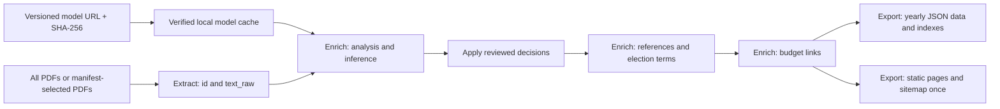

# Resolution classification architecture

`usneseni-mesta` owns the production inference code in
`resolution_classification/`. The separate
`litovle/litovel-resolution-classifier` repository owns model training,
curated datasets, taxonomy development and published model releases.
The pipeline consumes a release archive by URL and checksum. It imports no
code from the classifier repository and requires no second checkout.

## Data flow



Enrich classifies the complete accumulated raw corpus on each run. It attaches a
`classification` object to each analyzed resolution. Reference resolution,
budget linking and yearly JSON export preserve that object. Starting the
pipeline at Export reuses the existing Enrich decisions. Both yearly JSON
and pages read the final budget-linked resolutions. With `--without-budget`,
they read resolved resolutions instead and budget autodetection is disabled.
The numbered script and storage names are retained internal conventions.
The current website templates do not display thematic categories or category
filters; categories are available in the exported JSON data.

## Runtime modules and files

| Path | Purpose |
| --- | --- |
| `resolution_classification/bundle.py` | Download, checksum verification, extraction and verified cache reuse. |
| `resolution_classification/inference.py` | Local Transformer inference on raw resolution text. |
| `resolution_classification/decisions.py` | Apply exact-text manual overrides and review flags. |
| `resolution_classification/runner.py` | Connect bundle loading, inference and reviewed output. |
| `resolution_classification/final-v1/` | Matching v1 manifest, taxonomy, manual decisions and license notices. |
| `tests/test_classifier_bundle.py` | Bundle integrity, cache reuse, extraction and input coverage tests. |
| `tests/test_pipeline_classification.py` | Pipeline wiring and preservation of decisions through later phases. |
| `tests/test_pipeline_stages.py` | Named ranges, prerequisite/failure handling, dry runs and incremental workflow parsing. |
| `.cache/resolution-classifier/<archive-sha256>/` | Downloaded model files and metadata; ignored by Git and cached in Actions. |
| `work/classifier/` | Generated inference reports; contains no model weights. |

The runtime package, its final metadata and tests belong in this repository.
Historical training scripts and development reports are archived in the model
repository's `development-archive/`; they are not runtime dependencies.

Generated classifier reports are ignored by Git. Reviewed decisions remain in the
versioned resolution data; the reports can be regenerated by running Enrich.

`work/classifier/` contains:

- `classifications.jsonl`: raw model predictions with resolution text;
- `classification-summary.json`: counts and score/margin summaries;
- `review-queue.jsonl`: all predictions ordered by increasing margin and score;
- `reviewed-classifications.jsonl`: effective decisions with model evidence,
  version, source URL and archive checksum.

## Reviewed decision contract

For each resolution, `classification` records:

| Field | Meaning |
| --- | --- |
| `category` | Effective thematic category, or null for a known ambiguous resolution. |
| `source` | `model`, `manual_override`, or `manual_review`. |
| `status` | `classified` or `manual_review_required` for successful pipeline outputs. |
| `model_version`, `taxonomy_version` | Versions from the selected bundle manifest. |
| `model_url`, `model_sha256` | Release source and verified archive identity. |
| `prediction` | Original category, score, runner-up category/score, margin and entropy. |
| `reason` | Review explanation when supplied for an ambiguous resolution. |

Known review-required decisions withhold the effective category. Otherwise,
exact-text manual overrides take precedence over the model category. A manual
decision applies only when its stored resolution text matches the inference
input exactly. Low scores and margins order the review queue; they do not
automatically withhold a category. Scores are uncalibrated softmax values.

The runner stops on missing or duplicate prediction IDs, stale source text or
manual decisions, model categories outside the manifest's labels, invalid bundle
files, or checksum mismatches. Failed downloads do not publish a completed
cache directory. If cached files are damaged, remove that checksum's cache
directory and rerun to download and verify the release again.

## Model source and bundle format

Defaults are defined in `resolution_classification/__init__.py`:

- model: `v1.0.0`, taxonomy: `v7`;
- URL: `https://github.com/litovle/litovel-resolution-classifier/releases/download/v1.0.0/litovel-resolution-classifier-v1.0.0.tar.gz`;
- SHA-256: `6ad39105467ebd487349bb9b3ef6f2ea5ffcdf360ae1ac1190d410d7ebc0d69a`.

The published v1 archive contains model files only. After verifying that exact
archive checksum, the loader adds the matching metadata shipped in
`final-v1/`. This fallback applies only to the pinned v1 asset.

Other archives must contain these exact paths:

```text
model/config.json
model/tokenizer.json
model/tokenizer_config.json
model/model.safetensors
manifest.json
taxonomy/v7.md
data/manual-overrides-v1.jsonl
data/manual-review-required-v1.jsonl
MODEL_LICENSE.md
DATA_LICENSE.md
```

`manifest.json` must include `model_version`, `taxonomy_version`, and `labels`.
Annotation files are JSONL records keyed by resolution `id`, with exact source
`text`; overrides also require `category`, and review records may include
`reason`. Empty annotation files are valid. The current loader expects the
filenames above even for a custom bundle; changing that layout requires an
explicit loader/contract update.

For local execution:

```bash
python -m pip install -r requirements.txt
python pipeline.py --from-stage enrich --to-stage export
```

To select another complete release:

```bash
python pipeline.py --from-stage enrich --to-stage export \
  --classifier-url https://example.org/versioned-model.tar.gz \
  --classifier-sha256 YOUR_ARCHIVE_SHA256 \
  --classifier-cache .cache/resolution-classifier
```

`file:///absolute/path/model.tar.gz` is also supported for local archives.
Standalone `phase2_resolution_analysis.py` performs structural analysis unless
`--classifier-url` is supplied; the pipeline runner always supplies it in Enrich.

For a full directory-based run, use `python pipeline.py --pdf resources`.
For export-only operation, use `python pipeline.py --from-stage export`.
Add `--without-budget` for resolutions-only processing. Repeat this flag when
exporting an earlier resolutions-only Enrich run; stale budget-linked data is
never automatically selected in that mode. Existing output files are not
purged, so use a fresh export directory for an exclusive resolutions-only snapshot.
The numeric `--from-phase` and `--to-phase` options are removed.

## GitHub Actions

Both `sync-litovel-notices.yml` and `manual-litovel-pdf.yml` install CPU PyTorch
and the dependencies from `requirements.txt`. They first parse only PDFs listed
in their scan/manual manifests using the existing standalone parsers, preserving
previously accumulated records. They then invoke
`--from-stage enrich --to-stage export` with the model URL and checksum; no
directory-wide extraction occurs. Classification, references and budget links
still rebuild globally, and static export runs once. No new classification
reuse/cache is introduced. They cache model files with a key containing the runner
OS, archive checksum and hash of the packaged v1 manifest. Model caches live
outside `work/` and are excluded from the generated data pull requests.

Repository variables `RESOLUTION_CLASSIFIER_URL` and
`RESOLUTION_CLASSIFIER_SHA256` override the pinned defaults. Set both together
when selecting a different complete bundle. Cache misses download and verify
the release before inference; cache hits verify extracted file hashes and
reuse them. Inference can run on CPU, CUDA or MPS locally; the hosted workflows
install CPU wheels.

The workflows keep their existing scan/manual-input triggers and pull request
flow. No classifier checkout or external inference API is used. Local changes
to code and workflows take effect in hosted runs after being committed and
pushed to the branch those workflows execute.
