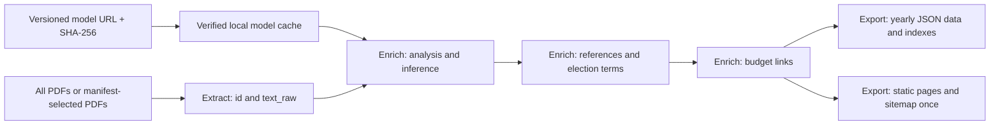

# Resolution classification architecture

`usneseni-mesta` owns the production inference code in
`resolution_classification/`. The separate
`litovle/litovel-resolution-classifier` repository owns model training,
curated datasets, taxonomy development and published model releases.
The pipeline consumes a release archive by URL and checksum. It imports no
code from the classifier repository and requires no second checkout.

## Data flow



Enrich analyzes the complete accumulated raw corpus on each run. In GitHub Actions,
`--incremental-classification` reuses a stored classification only when its ID,
`text_raw` SHA-256, model URL and model SHA-256 match. New or changed resolutions
are classified; when none need classification, the model is not loaded. Existing
classifications without `text_sha256` are classified once on the first incremental
run. Without the flag, all resolutions are classified. Enrich attaches a
`classification` object to each analyzed resolution. Reference resolution,
budget linking and yearly JSON export preserve that object. Starting the
pipeline at Export reuses the existing Enrich decisions. Both yearly JSON
and pages read the final budget-linked resolutions. With `--without-budget`,
they read resolved resolutions instead and budget autodetection is disabled.
The numbered script and storage names are retained internal conventions.
The website uses exported categories for a topic filter and labels. Topic-only
browsing needs no search phrase. Missing categories remain searchable under all
topics or the unclassified option. The browser never runs model inference.

## Runtime modules and files

| Path | Purpose |
| --- | --- |
| `resolution_classification/bundle.py` | Download, checksum verification, extraction and verified cache reuse. |
| `resolution_classification/inference.py` | Local Transformer inference on raw resolution text. |
| `resolution_classification/runner.py` | Connect bundle loading, inference and classification output. |
| `tests/test_classifier_bundle.py` | Bundle integrity, cache reuse, extraction and input coverage tests. |
| `tests/test_pipeline_classification.py` | Pipeline wiring and preservation of decisions through later phases. |
| `tests/test_pipeline_stages.py` | Named ranges, prerequisite/failure handling, dry runs and incremental workflow parsing. |
| `.cache/resolution-classifier/<archive-sha256>/` | Downloaded model files and metadata; ignored by Git and cached in Actions. |
| `work/classifier/` | Generated inference reports; contains no model weights. |

The runtime package and tests belong in this repository.
Historical training scripts and development reports are archived in the model
repository's `development-archive/`; they are not runtime dependencies.

Generated classifier reports are ignored by Git. In incremental mode they cover
only predictions made during the current run, including an empty report when
there are no changes. Model predictions remain in the
versioned resolution data; the reports can be regenerated by running Enrich.

`work/classifier/` contains:

- `classifications.jsonl`: raw model predictions with resolution text;
- `classification-summary.json`: counts and score/margin summaries;
- `review-queue.jsonl`: all predictions ordered by increasing margin and score;

## Classification contract

For each resolution, `classification` records:

| Field | Meaning |
| --- | --- |
| `category` | The model's thematic category. |
| `source` | `model`. |
| `status` | `classified`. |
| `model_url`, `model_sha256` | Release source and verified archive identity. |
| `text_sha256` | SHA-256 of the exact `text_raw` used for classification. |
| `prediction` | Category, score, runner-up category/score, margin and entropy. |

Predictions are used directly without training-data overrides or predefined
review flags. Low scores and margins order the review queue; they do not
withhold a category. Scores are uncalibrated softmax values. Confidence, runner-up confidence,
margin and entropy in attached classifications are rounded to two decimal places.
The ignored inference reports retain full precision. Categories are selected
before rounding; review ordering also uses the original scores. Rounding reduces
numerical diffs across devices but cannot guarantee identical results at rounding
boundaries.

The runner stops on missing or duplicate prediction IDs, stale source text,
model categories outside the config's labels, invalid bundle files, or checksum
mismatches. Failed downloads do not publish a completed cache directory. If
cached files are damaged, remove that checksum's cache directory and rerun.

## Model source and bundle format

Defaults are defined in `resolution_classification/__init__.py`:

- URL: `https://github.com/litovle/litovel-resolution-classifier/releases/download/v1.0.0/litovel-resolution-classifier-v1.0.0.tar.gz`;
- SHA-256: `6ad39105467ebd487349bb9b3ef6f2ea5ffcdf360ae1ac1190d410d7ebc0d69a`.

The current release and custom archives need only these files:

```text
model/config.json
model/tokenizer.json
model/tokenizer_config.json
model/model.safetensors
```

Categories come from `id2label` in `model/config.json`. Only these model files
are extracted; training metadata and manual decisions are ignored. The
human-readable taxonomy and model license documentation remain in the classifier
repository. The verified URL and archive checksum identify the deployed model.

For local execution:

```bash
python -m pip install -r requirements.txt
python pipeline.py --from-stage enrich --to-stage export
```

To select another complete release:

```bash
python pipeline.py --from-stage enrich --to-stage export \
  --classifier-url https://example.org/versioned-model.tar.gz \
  --classifier-sha256 YOUR_ARCHIVE_SHA256 \
  --classifier-cache .cache/resolution-classifier
```

`file:///absolute/path/model.tar.gz` is also supported for local archives.
Standalone `phase2_resolution_analysis.py` performs structural analysis unless
`--classifier-url` is supplied; the pipeline runner always supplies it in Enrich.

For a full directory-based run, use `python pipeline.py --pdf resources`.
For export-only operation, use `python pipeline.py --from-stage export`.
Add `--without-budget` for resolutions-only processing. Repeat this flag when
exporting an earlier resolutions-only Enrich run; stale budget-linked data is
never automatically selected in that mode. Existing output files are not
purged, so use a fresh export directory for an exclusive resolutions-only snapshot.
The numeric `--from-phase` and `--to-phase` options are removed.

## GitHub Actions

Both `sync-litovel-notices.yml` and `manual-litovel-pdf.yml` install CPU PyTorch
and the dependencies from `requirements.txt`. They first parse only PDFs listed
in their scan/manual manifests using the existing standalone parsers, preserving
previously accumulated records. They then invoke
`--from-stage enrich --to-stage export` with the model URL and checksum; no
directory-wide extraction occurs. Classification, references and budget links
still rebuild globally, and static export runs once. No new classification
reuse/cache is introduced. They cache model files with a key containing the runner
OS, model cache format version and archive checksum. Model caches live
outside `work/` and are excluded from the generated data pull requests.

Repository variables `RESOLUTION_CLASSIFIER_URL` and
`RESOLUTION_CLASSIFIER_SHA256` override the pinned defaults. Set both together
when selecting a different complete bundle. Cache misses download and verify
the release before inference; cache hits verify extracted file hashes and
reuse them. Inference can run on CPU, CUDA or MPS locally; the hosted workflows
install CPU wheels.

The workflows keep their existing scan/manual-input triggers and pull request
flow. No classifier checkout or external inference API is used. Local changes
to code and workflows take effect in hosted runs after being committed and
pushed to the branch those workflows execute.

## Website topic metadata

Export writes `assets/usneseni/topics.json`, mapping model category identifiers
to Czech labels. Labels are defined in `static_export/topics.py`; unknown model
categories use their identifiers as fallback labels. This is presentation data,
not a dependency on training taxonomy documents.

Generated resolution front matter includes `classification_category` and
`classification_label` when a category exists. The website layout uses these
fields for a topic link; yearly JSON preserves the original classification
object. Search stores a single topic in the `category` URL parameter, with
`unclassified` representing records without a category.
